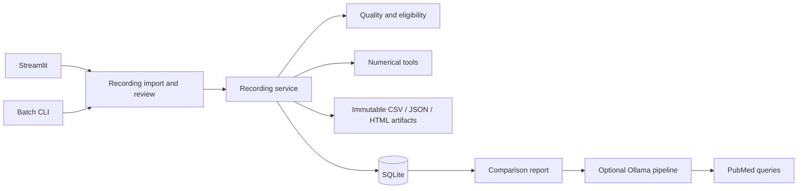

# System architecture

Updated 2026-10-24. See [DATA_FLOW.md](DATA_FLOW.md) for the complete recording
contract, eligibility rules, persistence semantics and compatibility limitations.

## Components

| Component | Responsibility |
|---|---|
| `app.py` | Authentication, tab navigation, previous results, comparison dashboard, optional AI reporting |
| `tools/analysis_view.py` | New recording import/review UI and report downloads |
| `tools/recording.py` | CSV adapters, explicit time/unit boundary, normalized Recording and provenance |
| `services/analysis_service.py` | Quality assessment and metric eligibility |
| `services/recording_service.py` | Numerical orchestration, optional strict PIM sleep inference, immutable artifacts, transactional persistence |
| `tools/sleep_*`, `activity_*`, `light_*` | Existing numerical algorithms |
| `tools/run_report.py` | Strict JSON conversion and standalone single-record HTML |
| `tools/database.py` | Schema and record access, authentication and existing AI cache |
| `tools/report_generator.py` | Two-record comparison; unique comparison JSON |
| `services/report_service.py` | Comparison API wrapper |
| `services/ai_pipeline_service.py` | Optional AI pipeline wrapper |
| `tools/llm_conversation.py`, `tools/pubmed_search.py` | Local LLM reporting and external literature retrieval |
| `scripts/analyze_recording.py` | Batch entry point to the same numerical workflow |

## Dependency boundaries

The normalized Recording owns measurements and source metadata. The numerical
service operates on a copy, returns structured outcomes, and has no Streamlit or
LLM dependency. Persistence is a separate explicit call. The UI owns user decisions
such as date selection and sleep edits; the CLI supports pre-labeled inputs.

New modalities should be registered through the importer, quality policy, service
and report contracts. Do not add a second metric-orchestration branch in `app.py`.
Keep experimental algorithms in `Development/` until tests and a reference dataset
justify integration. The OpenAI directory remains a separate legacy variant and
has not been migrated to the new numerical UI.

## AI boundary

The main optional AI path remains Ollama → PubMed → audience-specific report,
with optional anamnesis linking. New numerical reports do not require this path.
The new immutable numerical-run model does not change the older AI cache's upsert
semantics. Keyword generation and literature relevance/claim support still require
separate evaluation; local inference alone does not prove query deidentification.
