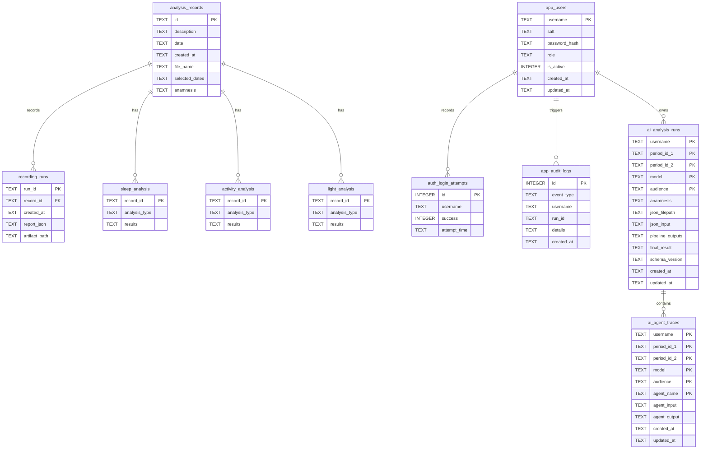

# Database Schema and Persistence

Primary database file: Actigraph_record.db (SQLite)
Primary access layer: tools/database.py (ActigraphDB)

## 1) Entity Relationship View



ASCII relationship view:

```text
analysis_records (1) -> (many) sleep_analysis/activity_analysis/light_analysis
app_users (1) -> (many) auth_login_attempts
app_users (1) -> (many) app_audit_logs
ai_analysis_runs (composite key) -> (many) ai_agent_traces
```

## 2) Table Roles

- analysis_records:
  - Master row per uploaded/processed period.
  - Stores metadata and selected_dates context.
- sleep_analysis, activity_analysis, light_analysis:
  - Metric storage by analysis_type with JSON results.
- ai_analysis_runs:
  - Cached complete AI run per user + period pair + model + audience.
- ai_agent_traces:
  - Per-agent input/output trace for audit and reproducibility.
- app_users:
  - PBKDF2 password entries and role.
- auth_login_attempts:
  - Lockout and brute-force resistance support.
- app_audit_logs:
  - Security and workflow audit events.

## 3) Write Paths

- services/recording_service.py writes atomically:
  - analysis_records
  - successful modality results in existing tables
  - recording_runs with full report/provenance and artifact path
- app.py writes:
  - ai_analysis_runs and ai_agent_traces
  - audit entries
- tools/report_generator.py reads modality tables and writes report JSON (file).
- tools/database.py owns schema creation and migrations.

## 4) Read Paths

- app.py tab views read records and analyses.
- report generation reads aggregated metrics by selected IDs.
- AI tab optionally loads cached ai_analysis_runs by exact key.

## 5) Artifacts Outside DB

- analysis_runs/<UUID>/{normalized.csv,report.json,report.html}
  - Created by services/recording_service.py; input snapshot and numerical report.
- analysis_runs/comparisons/<UUID>.json
  - Created by tools/report_generator.save_json_report; optional AI pipeline input.
- ai_analyses/*.txt and *.meta.json
  - Snapshot outputs created by app.py for user-level history.

## 6) Modality Extension Rules

To add a new modality table:

1. Add CREATE TABLE block in ActigraphDB.init_database.
2. Add save/get/aggregate support methods.
3. Include table in allowed table list used by aggregation routines.
4. Update report generator and docs to include modality in output contracts.

## Numerical-run migration and retention

`init_database()` adds `recording_runs` with `CREATE TABLE IF NOT EXISTS`; existing
records and metric blobs are unchanged. `get_recording_run` returns None for old
records. There is no fabricated backfill or automatic numerical recalculation.
The application inserts each new run once and requires a new Analysis ID for reruns.

SQLite writes for a numerical run are transactional. Artifact/DB crash consistency,
backup and deletion behavior are documented in DATA_FLOW.md. The existing AI-run
and agent-trace composite-key caches still use upserts; they are not immutable.
Numerical-record ownership remains the legacy shared local-database model.

Last verified against codebase state: 2026-10-24.
