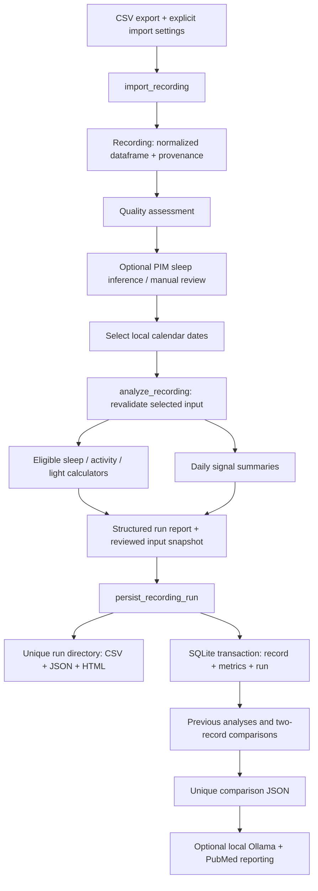

# Recording-to-report data flow

Implemented 2026-10-24. This document describes the main numerical workflow.
The existing optional comparison-to-LLM workflow is described in AGENT_PIPELINE.md.

## Flow

Streamlit (`tools/analysis_view.py`) and the CLI (`scripts/analyze_recording.py`)
call the same analysis and persistence functions. Numerical analysis never calls
an LLM or PubMed. Streamlit provides optional sleep inference and editing; the CLI
uses supplied sleep labels and never infers them implicitly.

## 1. Import contract

`tools/recording.py` defines `Recording(data, metadata)` and `ImportOptions`.
The importer accepts comma-, semicolon-, or tab-separated files, including legacy
exports with up to 49 preamble lines. The first header containing an accepted
timestamp column is used. UTF-8 and Latin-1 are supported.

| Field | Contract |
|---|---|
| `DATE/TIME` | Required; timezone-aware after import. `Timestamp`/`timestamp` aliases accepted. |
| `PIMn` | Optional, nonnegative **device PIM counts**. ENMO/raw acceleration are not automatically mapped. |
| `MELANOPIC EDI` | Optional, nonnegative melanopic EDI in lux. `MelanopicEDI` alias accepted. |
| `WHITE LIGHT (LUX)` | Optional photopic lux; never substituted for melanopic EDI. |
| `TEMPERATURE` | Optional skin temperature in Celsius. No implicit Fahrenheit conversion. |
| `SLEEP_STATE` | Optional binary 0=wake, 1=sleep. `SLEEP/WAKE` alias accepted. Unknown stays missing. |
| `TATn`, `ZCMn` | Optional device-specific measures, retained with descriptive summaries. |
| `DATE`, `TIME`, `HOUR`, `Transition` | Derived from the chosen local timezone. |
| Other source columns | Preserved for traceability; not automatically interpreted. |

Explicit column mapping maps **source header → standard header**. Mapping to a
standard signal asserts its units and meaning. This is an integration contract,
not a validated ActiHub firmware decoder. A real ActiHub export specification and
calibration evidence are still needed for that adapter.

Import options record timezone, date order (`dayfirst`, `monthfirst`, `iso`), device
label and column mapping. Offset-bearing timestamps are converted to the selected
local timezone. Naive timestamps are localized there. Ambiguous/nonexistent DST
times and duplicate timestamps are rejected, not shifted or averaged. Invalid
signal values become missing and their counts are retained in metadata.

The original bytes are SHA-256 hashed. The original file is not copied into the
run directory; keep it separately if byte-for-byte source reconstruction is needed.

## 2. Quality and preprocessing

`data_quality_report` distinguishes structural errors from warnings and per-family
eligibility. Import/analysis errors stop the run; missing optional signals do not.

- Input must contain valid, unique, timezone-aware timestamps and a usable signal.
- Sampling interval, gaps, signal missingness, and DST dates are reported.
- Existing rhythm algorithms require one-minute samples. Unsupported sampling is
  retained for descriptive summaries; no automatic resampling is performed.
- Activity/light rhythm analysis excludes calendar dates with less than 70% valid
  samples (configurable `minimum_day_coverage`). This is an engineering quality
  gate, **not a clinically validated threshold**. Existing algorithm-specific
  window rules also apply; review coverage before interpreting outputs.
- Legacy activity/light rhythm and sleep-bout metrics are withheld on selections
  containing DST transition dates. This conservative policy avoids implying that
  legacy 24-hour assumptions have been validated for 23/25-hour days.
- Bout and sleep/light calculations require a continuous one-minute selection and
  complete sleep labels. Sleep/light also requires complete melanopic samples.
- SRI retains missing calendar days and all 1,440 wall-clock slots in its coverage
  denominator. It compares consecutive calendar days, excludes DST transition
  days, and reports valid pair percentage. A high SRI with low pair coverage is
  not equivalent to a well-observed result; no normative interpretation is made.
- Optional Roenneberg inference requires continuous valid PIM samples, uses fixed
  recorded parameters, performs no imputation, and never substitutes all-wake
  labels on failure. Manual review is available for complete PIM/sleep recordings.

The selected, reviewed dataframe is copied before calculation. `EDITED` flags and
actual sleep labels are preserved in the snapshot. Unknown sleep is not converted
to wake by the new service. Original legacy helper functions remain available;
external callers should use the service to obtain these eligibility protections.

## 3. Numerical orchestration

`analyze_recording` invokes the existing sleep/activity/light tools, retaining their
output names for compatibility. It produces one result per attempted metric:

- `completed`: calculated output;
- `unavailable`: calculator returned no rows;
- `skipped`: input prerequisites were not met;
- `failed`: calculator raised an exception, with the error retained.

A run is `partial` if any calculator fails, `summary_only` if no metric completes,
or `completed` otherwise. Completed runs may still contain intentionally skipped
metrics. The report always includes the outcome table and quality context.

Sleep bouts now include elapsed `duration_minutes`. The single-record report adds
mean, minimum, maximum and population SD in minutes. The comparison report labels
mean/minimum/SD explicitly and preserves requested period order. Legacy records
without elapsed duration use their stored local onset/offset fields, so their
historical DST uncertainty cannot be reconstructed automatically.

## 4. Persistence and reproducibility

Each run receives a random UUID and a new `analysis_runs/<UUID>/` directory:

- `normalized.csv`: selected data actually analyzed, including reviewed sleep;
- `report.json`: strict JSON (missing/nonfinite numbers become `null`);
- `report.html`: standalone escaped HTML, daily plots/tables, quality, methods and outcomes.

The JSON contains the source hash, normalized snapshot hash, import options,
selected dates, calculation parameters, package/Python versions, and source-file
hashes for the application, tools and services. Hashes identify code but do not
archive it: retain the matching source checkout and dependency environment.

Persistence checks the snapshot hash and refuses an existing run directory.
With a database, the master record, successful legacy metric rows, and complete
`recording_runs` report are inserted in one SQLite transaction. A duplicate
Analysis ID fails rather than replacing prior results; use a new ID for reruns.
Failures roll back the DB and remove only the newly created directory.

The filesystem and SQLite are not one distributed transaction. A process/power
failure between artifact writing and DB commit can leave an orphan directory.
A DB record should never point to artifacts that were not written first. Back up
both the database and `analysis_runs/`; the existing DB backup script covers only
SQLite. Deleting a record removes its run row but deliberately retains exported
artifact directories for explicit retention management.

Comparison JSON uses `analysis_runs/comparisons/<UUID>.json`; the app passes the
returned path to the existing AI pipeline. There is no shared overwrite target.
An explicitly supplied comparison filename must also be new (`open(..., 'x')`).

## 5. What this milestone does not establish

- Hardware measurement equivalence or validated conversion between wearable types.
- Clinical validity of the legacy metrics or generated interpretations.
- A production-ready multi-tenant access-control model: numerical records retain
  the existing shared database visibility for authenticated local users.
- Validated temperature/phasor metrics, or selection of the experimental LLM variants.
- Automatic migration/recalculation of historical results or historical AI caches.

Use synthetic or approved deidentified recordings for the first researcher pilot.
